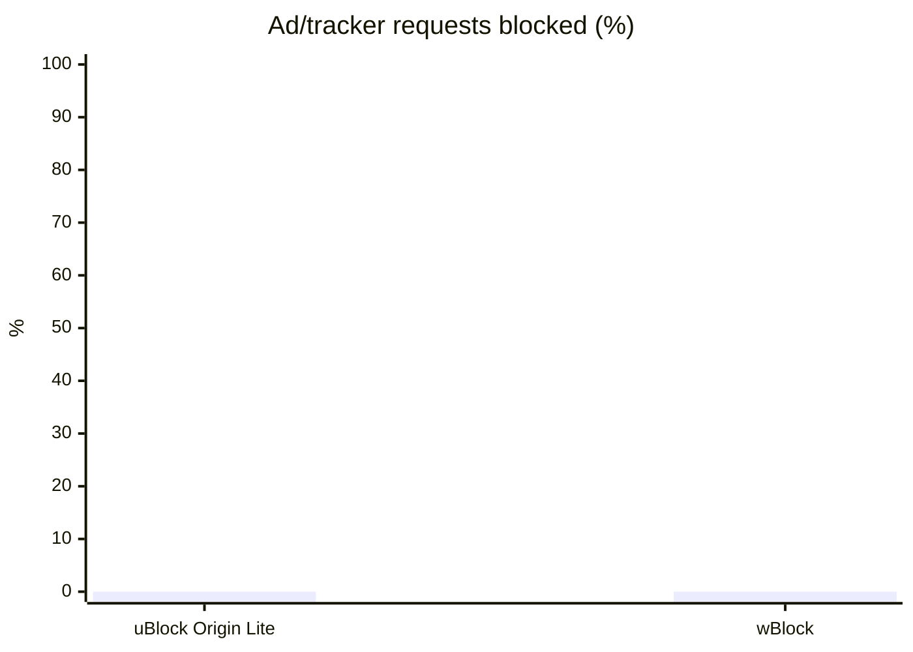
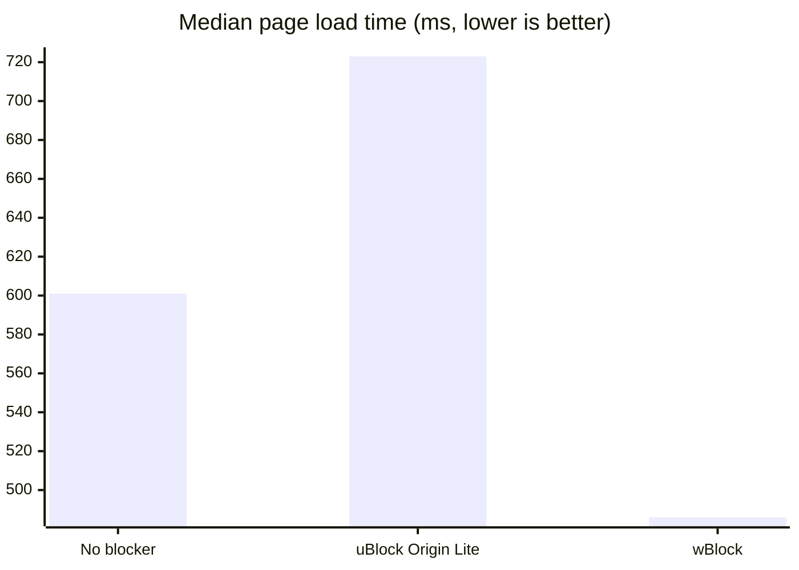

# Safari Ad Blocker Benchmark

Automated, repeatable comparison of Safari ad-blocking extensions on GitHub-hosted macOS
runners: how much they block, what they cost in page-load speed and memory, and whether
they break pages.

## Results

<!-- RESULTS:START -->
_Last run: 2026-11-01 · Safari 26.6.2 · macOS 26.6.2 · GitHub-hosted runner. Deltas compare each blocker with a no-blocker baseline measured on the same runner._

### Ad blocking

| Extension | Ad/tracker requests blocked | Ad elements hidden | Ad requests per page (none → with blocker) | Nothing broken |
|---|---|---|---|---|
| **uBlock Origin Lite** | 0% (0/25) | 0% (0/10) | 51 → 40 (21.6% fewer) | ✅ |
| **wBlock** | 0% (0/25) | 0% (0/10) | 46 → 54 (-17.4% fewer) | ✅ |

### Speed

| Extension | Median page load (none → with blocker) | Change | Data transferred | Speedometer 3.1 (none → with blocker) |
|---|---|---|---|---|
| **uBlock Origin Lite** | 518 ms → 723 ms | +39.6% | -24.5% | 11.5 → 12.2 |
| **wBlock** | 684 ms → 486 ms | -28.9% | +0.5% | 10.3 → 12.9 |

### Memory (Safari + WebKit + extension processes)

| Extension | Idle | Δ idle | 6 sites open | Δ with sites open |
|---|---|---|---|---|
| **uBlock Origin Lite** | 485 MB | +32.8 MB | 3118 MB | -59.5 MB |
| **wBlock** | 505 MB | +91.4 MB | 3389 MB | +316 MB |





<details><summary>Test requests that weren't blocked</summary>

- **uBlock Origin Lite**: `pagead2.googlesyndication.com`, `securepubads.g.doubleclick.net`, `www.googletagservices.com`, `static.doubleclick.net`, `www.google-analytics.com`, `www.googletagmanager.com`, `connect.facebook.net`, `static.ads-twitter.com`, `c.amazon-adsystem.com`, `cdn.taboola.com`, `widgets.outbrain.com`, `acdn.adnxs.com`, `bat.bing.com`, `snap.licdn.com`, `static.hotjar.com`, `cdn.mxpnl.com`, `sb.scorecardresearch.com`, `www.clarity.ms`, `static.criteo.net`, `ads.pubmatic.com`, `mc.yandex.ru`, `secure.quantserve.com`, `js-agent.newrelic.com`, `s.pinimg.com`, `analytics.tiktok.com`
- **wBlock**: `pagead2.googlesyndication.com`, `securepubads.g.doubleclick.net`, `www.googletagservices.com`, `static.doubleclick.net`, `www.google-analytics.com`, `www.googletagmanager.com`, `connect.facebook.net`, `static.ads-twitter.com`, `c.amazon-adsystem.com`, `cdn.taboola.com`, `widgets.outbrain.com`, `acdn.adnxs.com`, `bat.bing.com`, `snap.licdn.com`, `static.hotjar.com`, `cdn.mxpnl.com`, `sb.scorecardresearch.com`, `www.clarity.ms`, `static.criteo.net`, `ads.pubmatic.com`, `mc.yandex.ru`, `secure.quantserve.com`, `js-agent.newrelic.com`, `s.pinimg.com`, `analytics.tiktok.com`

</details>
<!-- RESULTS:END -->

## Extensions tested

| Extension | Type | Source of binary |
|---|---|---|
| uBlock Origin Lite | Safari web extension (declarativeNetRequest) | Mac App Store build |
| wBlock | Safari content blockers + web extension | Notarized Developer ID build |

## How it works

Each extension gets its own fresh macOS runner (a matrix job). On that runner:

1. **Baseline:** Safari is benchmarked with no blocker installed.
2. **Install:** the extension's app is unzipped into `/Applications`, registered with
   LaunchServices/`pluginkit`, and switched on in Safari → Settings → Extensions by UI scripting
   (`scripts/enable_in_safari.applescript`).
3. **With blocker:** the same benchmark runs again.

Comparing with a baseline from the *same* runner cancels out most of the variation between the
shared virtual machines GitHub hands out.

### What's measured

| Test | How |
|---|---|
| **Ad/tracker requests blocked** | `fixtures/adtest.html` tries to load 25 well-known ad and tracker scripts. A request counts as blocked if it never shows up in the Resource Timing API. Only scripts that loaded in the baseline count, so a host that's unreachable from CI isn't scored as "blocked". |
| **Ad elements hidden** | Elements on the same page that EasyList's generic hiding rules target (`.adsbygoogle`, `#ad_banner`, `div-gpt-ad-*`, …). |
| **Breakage** | Two normal CDN scripts and a plain element on the page must still load and stay visible. |
| **Ad requests on real sites** | Each site in `harness/sites.json` is loaded and every request to a domain in `harness/ad_hosts.txt` is counted. |
| **Page load time** | `loadEventEnd` from the Navigation Timing API, median of N loads per site after one discarded warm-up load, then the median across sites. |
| **Data transferred** | Sum of the `transferSize` values reported for the page. |
| **Memory** | Resident memory (RSS) of Safari, the WebKit helper processes and the extension's own processes, measured idle and with 6 sites open in tabs (median of 5 samples). |
| **Speedometer 3.1** | Browser responsiveness score, to show the overhead a blocker adds on pages without ads. |

### Caveats

- GitHub runners are shared VMs, so absolute numbers are noisy. Rely on the same-runner deltas and the trend across runs, not one run.
- Real sites change constantly and some block datacenter IPs. Failed loads are excluded from the comparison.
- Cross-origin `transferSize` is often reported as 0, which makes "data transferred" an undercount.
- Speedometer pages contain no ads, so a good score here means the blocker adds little overhead. It doesn't measure blocking.

## Adding or updating an extension

```sh
scripts/package.sh "/Applications/Some Blocker.app" some-blocker   # writes extensions/some-blocker.zip
```

Then add an entry to `extensions/manifest.json`:

```json
{ "id": "some-blocker", "name": "Some Blocker", "archive": "extensions/some-blocker.zip",
  "app": "Some Blocker.app", "setup_hook": null }
```

`setup_hook` is an optional script that runs after install, for apps that need first-run setup
before blocking (wBlock, for example, downloads and compiles its filter lists in the app).

## Running

Actions → **Benchmark Safari ad blockers** → *Run workflow*. It also runs weekly. Each job
uploads `diag-<id>` artifacts (screenshots, the Safari Settings UI dump, `pluginkit` state) for
debugging the install and enable steps.
