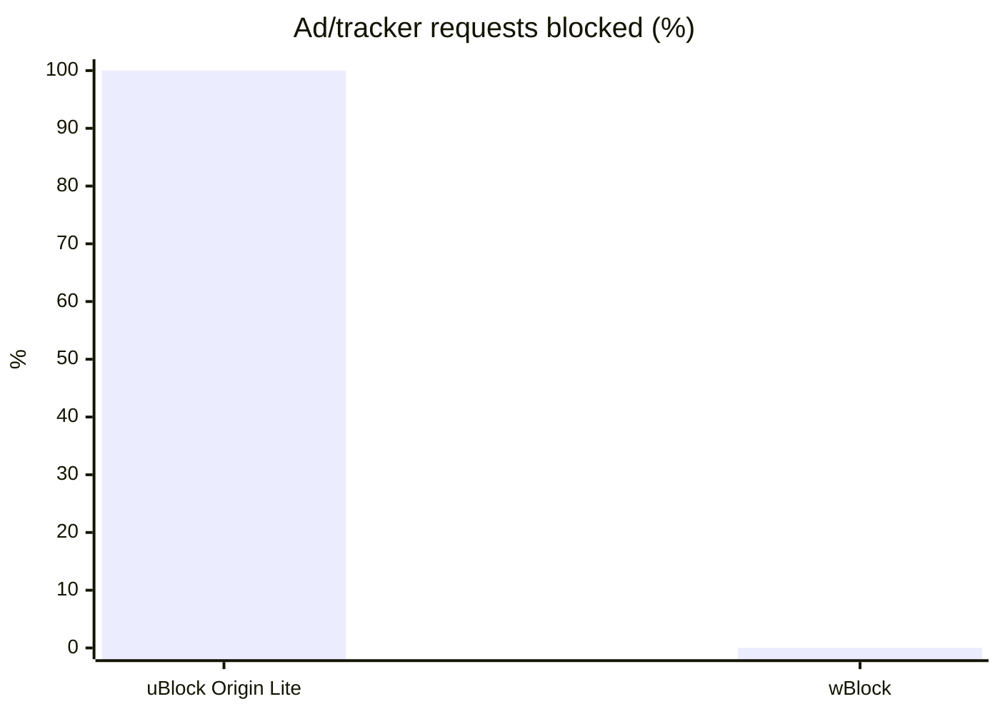
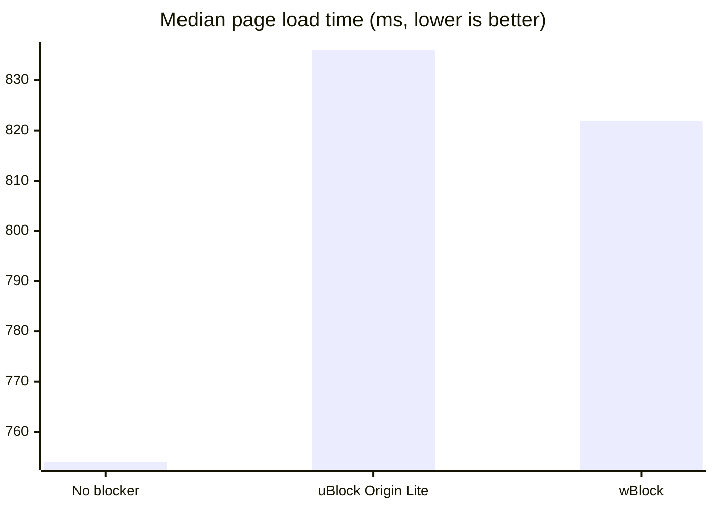
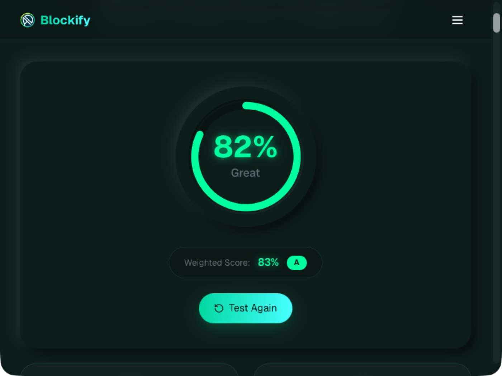
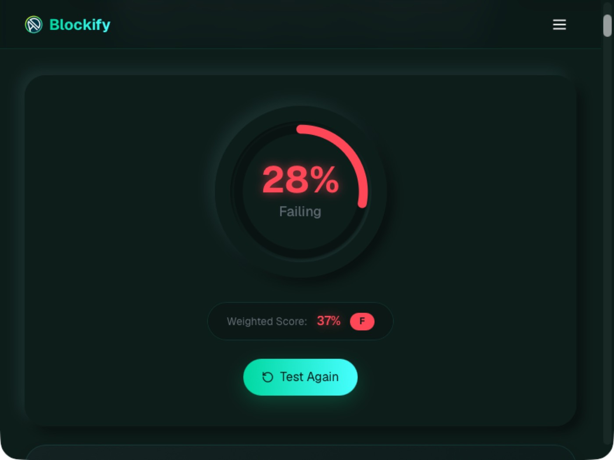
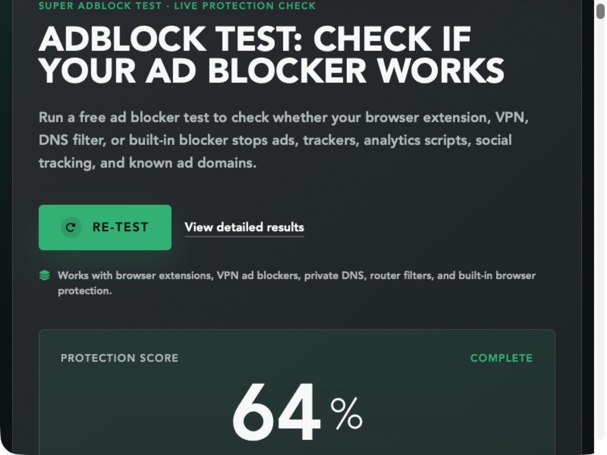

# Safari Ad Blocker Benchmark

Automated, repeatable comparison of Safari ad-blocking extensions on GitHub-hosted macOS
runners: how much they block, what they cost in page-load speed and memory, and whether
they break pages.

## Results

<!-- RESULTS:START -->
_Last run: 2026-11-02 · Safari 26.6.2 · macOS 26.6.2 · GitHub-hosted runner. Deltas compare each blocker with a no-blocker baseline measured on the same runner._

### Was the blocker active?

Test-page requests blocked in a normal Safari window and in a WebDriver (automation) window, which runs the speed, real-site and test-site benchmarks. Both should be well above 0; a 0 means the blocker wasn't active in that window for that run (see `results/diag/`).

| Extension | Normal window | WebDriver window |
|---|---|---|
| **uBlock Origin Lite** | 0/25 | 25/25 |
| **wBlock** | 0/25 | 0/25 |

### Ad blocking

Real-site columns are medians across the sites in `harness/sites.json`, without → with the blocker.

| Extension | Ad/tracker requests blocked (test page) | Ad requests per page (real sites) | Visible ads per page (real sites) | Generic hiding rules (test page) | Nothing broken |
|---|---|---|---|---|---|
| **uBlock Origin Lite** | 100% (25/25) | 65.5 → 1.5 (97.7% fewer) | 11 → 2.5 (77.3% fewer) | 0/10 | ✅ |
| **wBlock** | 0% (0/25) | 59 → 30 (49.2% fewer) | 9.5 → 8.5 (10.5% fewer) | 0/10 | ✅ |

_Generic hiding rules hide ad-like elements on any site. Some blockers only use them in a non-default mode (uBlock Origin Lite: "Complete"), so 0 there is expected with default settings. Visible ads on real sites is the better measure of hidden ads._

### Public ad-block test sites (score, higher is better)

_Scores are read from each page's text after the test finishes (best effort; see screenshots)._

| Test site | No blocker | uBlock Origin Lite | wBlock |
|---|---|---|---|
| AdBlock Tester (turtlecute) | 7.6% | 60.6% | — |
| Blockify Ad-Blocker Test | 33% | 83% | 37% |
| Super Adblock Test | 11% | 64% | 14% |
| adblock-tester.com | 41% | 91% | 100% |

### Speed

| Extension | Median page load (none → with blocker) | Change | Data transferred | Speedometer 3.1 (none → with blocker) |
|---|---|---|---|---|
| **uBlock Origin Lite** | 834 ms → 836 ms | +0.2% | -29.6% | 12.8 → 10.6 |
| **wBlock** | 675 ms → 822 ms | +21.8% | +5% | 11.9 → 14.6 |

### Memory (Safari + WebKit + extension processes)

| Extension | Idle | Δ idle | 6 sites open | Δ with sites open |
|---|---|---|---|---|
| **uBlock Origin Lite** | 1420 MB | +1054 MB | 2899 MB | -330 MB |
| **wBlock** | 745 MB | +401 MB | 3510 MB | +543 MB |





<details><summary>Screenshots (normal Safari window)</summary>

| Page | No blocker | uBlock Origin Lite | wBlock |
|---|---|---|---|
| `adblock-tester-com` |  |  |  |
| `adblock-turtlecute-org` |  |  |  |
| `canyoublockit-com-extreme-test` |  |  |  |
| `fixture` |  |  |  |
| `getblockify-com-adblock-test` |  |  |  |
| `superadblocktest-com` |  |  |  |

</details>

<details><summary>Test requests that weren't blocked</summary>

- **wBlock**: `pagead2.googlesyndication.com`, `securepubads.g.doubleclick.net`, `www.googletagservices.com`, `static.doubleclick.net`, `www.google-analytics.com`, `www.googletagmanager.com`, `connect.facebook.net`, `static.ads-twitter.com`, `c.amazon-adsystem.com`, `cdn.taboola.com`, `widgets.outbrain.com`, `acdn.adnxs.com`, `bat.bing.com`, `snap.licdn.com`, `static.hotjar.com`, `cdn.mxpnl.com`, `sb.scorecardresearch.com`, `www.clarity.ms`, `static.criteo.net`, `ads.pubmatic.com`, `mc.yandex.ru`, `secure.quantserve.com`, `js-agent.newrelic.com`, `s.pinimg.com`, `analytics.tiktok.com`

</details>
<!-- RESULTS:END -->

## Extensions tested

| Extension | Type | Source of binary |
|---|---|---|
| uBlock Origin Lite | Safari web extension (declarativeNetRequest) | Mac App Store build |
| wBlock | Safari content blockers + web extension | Notarized Developer ID build |

## How it works

Each extension gets its own fresh macOS runner (a matrix job). On that runner:

1. **Baseline:** Safari is benchmarked with no blocker installed.
2. **Install:** the extension's app is unzipped into `/Applications`, registered with
   LaunchServices/`pluginkit`, and switched on by writing Safari's extension-state files
   (`scripts/enable_in_safari.py`). Web extensions are also granted "Always allow on every website".
   Each extension runs with its default settings, after its app's first-run setup if it has one.
3. **With blocker:** the same benchmark runs again.

Comparing with a baseline from the *same* runner cancels out most of the variation between the
shared virtual machines GitHub hands out.

### What's measured

| Test | How |
|---|---|
| **Ad/tracker requests blocked** | `fixtures/adtest.html` tries to load 25 well-known ad and tracker scripts. A request counts as blocked if it never shows up in the Resource Timing API. Only scripts that loaded in the baseline count, so a host that's unreachable from CI isn't scored as "blocked". |
| **Generic hiding rules** | Elements on the same test page that EasyList's generic hiding rules target (`.adsbygoogle`, `#ad_banner`, `div-gpt-ad-*`, …). These rules apply on any site. Some blockers only use them in a non-default mode, so this can be 0 with default settings. |
| **Breakage** | Two normal CDN scripts and a plain element on the page must still load and stay visible. |
| **Ad requests on real sites** | Each site in `harness/sites.json` is loaded and every request to a domain in `harness/ad_hosts.txt` is counted. |
| **Visible ads on real sites** | After each page loads (and is scrolled once to trigger lazy-loaded ads), visible ad slots are counted: Google ad tags and iframes, Taboola and Outbrain widgets, elements labelled "Advertisement", and similar. Only slots at least 30×30 px count, and nested slots count once. This captures both blocked ad requests and hidden ad elements. |
| **Page load time** | `loadEventEnd` from the Navigation Timing API, median of N loads per site after one discarded warm-up load, then the median across sites. |
| **Data transferred** | Sum of the `transferSize` values reported for the page. |
| **Memory** | Resident memory (RSS) of Safari, the WebKit helper processes and the extension's own processes, measured idle and with 6 sites open in tabs (median of 5 samples). |
| **Public test sites** | [adblock-tester.com](https://adblock-tester.com/), [AdBlock Tester](https://adblock.turtlecute.org/), [Super Adblock Test](https://superadblocktest.com/) and [Blockify's test](https://getblockify.com/adblock-test) are run, and each score is read once it stops changing. [Can You Block It](https://canyoublockit.com/extreme-test/) has no score, so it's screenshot only. Screenshots of every page are in the gallery above. Each site uses its own method, so compare blockers within a site rather than across sites. |
| **Speedometer 3.1** | Browser responsiveness score, to show the overhead a blocker adds on pages without ads. |

### Caveats

- GitHub runners are shared VMs, so absolute numbers are noisy. Rely on the same-runner deltas and the trend across runs, not one run.
- Real sites change constantly and some block datacenter IPs. Failed loads are excluded from the comparison.
- Cross-origin `transferSize` is often reported as 0, which makes "data transferred" an undercount.
- Speedometer pages contain no ads, so a good score here means the blocker adds little overhead. It doesn't measure blocking.

## Adding or updating an extension

```sh
scripts/package.sh "/Applications/Some Blocker.app" some-blocker   # writes extensions/some-blocker.zip
```

Then add an entry to `extensions/manifest.json`:

```json
{ "id": "some-blocker", "name": "Some Blocker", "archive": "extensions/some-blocker.zip",
  "app": "Some Blocker.app", "setup_hook": null }
```

`setup_hook` is an optional script that runs after the extension is enabled, for apps that need
first-run setup before they block anything. wBlock's (`scripts/hooks/wblock.sh`) clicks through its
onboarding with the default choices, then waits while the app downloads and compiles its filter lists.

## Running

Actions → **Benchmark Safari ad blockers** → *Run workflow*. It also runs weekly. Each job
uploads `diag-<id>` artifacts (screenshots, the Safari Settings UI dump, `pluginkit` state) for
debugging the install and enable steps.
